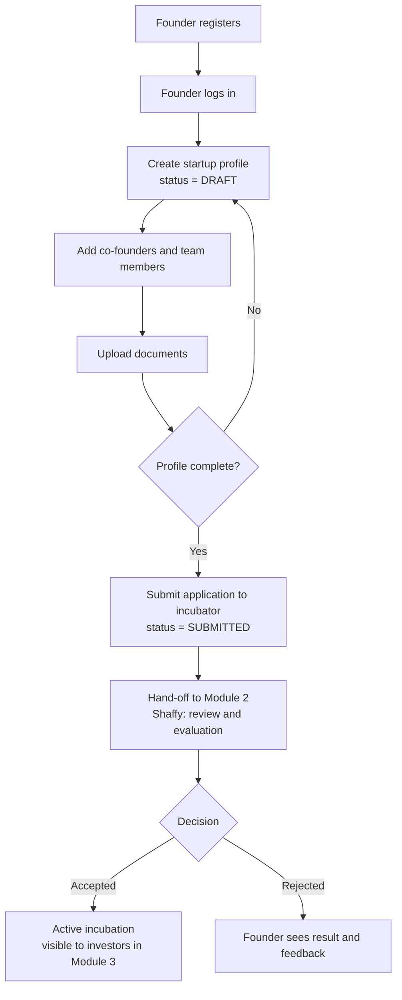

# Module 1: Startup & Founder Management

**Status:** Day 1 draft. Items marked *(to confirm)* need team agreement.

## 1. Scope of this module

- Founder registration and profile
- Startup creation, profile and editing
- Team member management
- Startup document upload (metadata in MySQL, files in a project folder)
- Submitting a startup for incubation (hand-off to Module 2)
- Startup 360° data provider (combined view of a startup's data)

**Shared responsibility (Day 2-3):** database foundation (schema conventions, `DBConnection`, transaction helper, setup guide).

---

## 2. Startup fields (`startups`)

| Field | Description | Example |
|---|---|---|
| startup_id | unique ID (PK) | 1 |
| startup_name | name of the startup (unique) | GreenRoute |
| sector | industry *(to confirm values)* | AgriTech |
| stage | Idea / Prototype / MVP / Revenue *(to confirm values)* | MVP |
| description | short summary | Route planning for farm produce |
| website | link (optional) | greenroute.in |
| location | city | Chandigarh |
| founded_date | date | 2025-03-10 |
| funding_needed | amount, DECIMAL *(to confirm)* | 500000 |
| status | position in the journey *(to confirm values)* | DRAFT |
| created_at | when it was added | timestamp |

---

## 3. Founder fields (`founders`)

| Field | Description | Example |
|---|---|---|
| founder_id | unique ID (PK) | 1 |
| user_id | links to shared `users` table; name, email and password are stored there *(to confirm)* | 5 |
| phone | contact number | 9876543210 |
| qualification | education | B.Tech CSE |
| experience_years | years of experience | 3 |
| linkedin_url | profile link (optional) | linkedin.com/in/... |
| bio | short intro | Passionate about AgriTech |

### Link table: `startup_founders`

A startup can have several founders, and a founder can belong to more than one startup, so a link table connects them.

| Field | Description |
|---|---|
| startup_id | which startup (FK) |
| founder_id | which founder (FK) |
| role_title | e.g. CEO, Co-founder |

---

## 4. Team member fields (`startup_teams`)

Team members are people on the startup's team. They do not need to log in.

| Field | Description | Example |
|---|---|---|
| team_member_id | unique ID (PK) | 1 |
| startup_id | which startup (FK) | 1 |
| full_name | member's name | Ravi Kumar |
| role_title | role in the team | CTO |
| email | contact email | ravi@example.com |
| phone | contact number (optional) | 9812345678 |
| joined_date | when they joined | 2025-04-01 |

---

## 5. Document fields (`startup_documents`)

Only information about the file is stored in MySQL. The file itself is stored in the project's `documents/` folder.

| Field | Description | Example |
|---|---|---|
| document_id | unique ID (PK) | 1 |
| startup_id | which startup (FK) | 1 |
| document_type | Pitch Deck / Business Plan / Registration Certificate / Other | Pitch Deck |
| original_file_name | name the user selected | deck.pdf |
| stored_file_name | safe name used when saving | 1_pitch_deck_20260115.pdf |
| file_path | where the file is stored | documents/1_pitch_deck_20260115.pdf |
| file_size_kb | size of the file | 540 |
| uploaded_by | user who uploaded (FK to users) | 5 |
| uploaded_at | upload time | timestamp |

**Rules:** only allow agreed file types (e.g. PDF, DOCX, PNG), enforce a size limit, and never trust the user-provided file name.

---

## 6. Startup journey statuses *(to confirm with Shaffy)*

Proposed vocabulary, based on the project plan's incubation journey tracker:

`DRAFT` → `SUBMITTED` → `UNDER_REVIEW` → `SHORTLISTED` → `ACCEPTED` / `REJECTED` → `ACTIVE_INCUBATION` → `COMPLETED`

---

## 7. Workflow: registration → profile → application hand-off

### Step-by-step

1. The founder registers and logs in (shared auth, Shaffy).
2. The founder creates a startup profile, with status DRAFT.
3. The founder adds team members and uploads documents.
4. The system checks that required fields are filled in.
5. The founder submits the application and the status becomes SUBMITTED.
6. Module 2 reviews and evaluates it, and the status changes from there.
7. Module 3 can show approved startups to investors.

---

## 8. Validation rules (draft)

- Startup name, sector, stage and location are required.
- Startup name must be unique.
- Email must have a valid format; phone must be a valid number.
- `funding_needed` must be greater than 0.
- A founder cannot edit core startup details after submission, except allowed fields.
- Documents must be an allowed type and within the size limit.

---

## 9. Interfaces with other modules (draft)

**Module 1 provides:**
- Get a startup by ID
- Get startups by status
- Update a startup's status
- Get combined startup data (for Startup 360°)

**Module 1 needs:**
- From Module 2 (Shaffy): login and role-check service; a way to create an application for a startup
- From Module 3 (Aastha): shared JavaFX shell and alert/dialog helpers

---

## 10. To confirm with team

- [ ] `users` table and `user_id` type (Shaffy)
- [ ] Primary key names and types across all tables
- [ ] Allowed values for `sector`, `stage` and `status`
- [ ] `funding_needed` type (DECIMAL) and currency
- [ ] Can one founder own more than one startup?
- [ ] Which documents are mandatory?
- [ ] Naming convention: snake_case columns, camelCase Java
