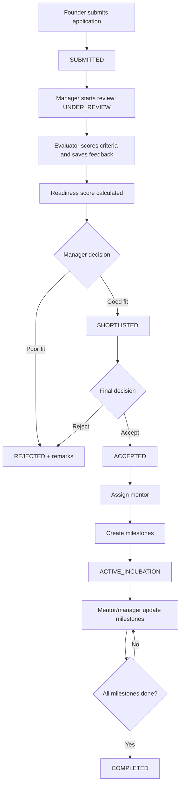

# Module 2 Requirements: Incubation & Evaluation

**Owner:** Shaffy
**Project:** UCS553 Startup Incubation & Investment Management Platform
**Phase:** Day 1 (Requirements, workflows and module boundaries)
**Status:** Draft for team review

---

## 1. Module Purpose

Module 2 covers everything that happens to a startup *after* it applies to an incubator: application review, evaluation scoring, the accept/reject decision, mentor assignment and milestone tracking.

**Owned tables (planned):** `incubators`, `programs`, `applications`, `evaluators`, `evaluation_criteria`, `evaluations`, `evaluation_scores`, `mentors`, `mentor_assignments`, `milestones`, `milestone_updates`

**Shared responsibility (Day 2-3):** common authentication/authorization (user/role contract, login service, role-check helper).

**Hand-off points with other modules**

| From / To | What is exchanged |
|---|---|
| Module 1 (Anshika) → Module 2 | `startup_id` of a startup whose application is submitted |
| Module 2 → Module 1 | Application status, readiness score and milestone progress for the Startup 360° profile |
| Module 2 → Module 3 (Aastha) | Startups reaching `ACTIVE_INCUBATION` / `COMPLETED` count as "approved" for investor discovery |

---

## 2. Roles Involved (proposed, to be agreed by all)

| Role | Relevance to Module 2 |
|---|---|
| `ADMIN` | Manage incubators, programs, evaluators and mentors; view everything |
| `INCUBATOR_MANAGER` | Review applications, shortlist, accept/reject, assign mentors, create milestones |
| `EVALUATOR` | Score assigned applications against criteria and give feedback |
| `MENTOR` | View assigned startups, add feedback on milestones |
| `FOUNDER` | Submit an application, view its status and milestones (read-only) |
| `INVESTOR` | No access to Module 2 operations (only approved startup results) |

Permissions are enforced in the **service layer**, not only by hiding buttons.

---

## 3. Entities and Fields

Conventions: PK = primary key, FK = foreign key, `created_at` / `updated_at` are `DATETIME`, money is `DECIMAL(15,2)`, calendar deadlines are `DATE`.

### 3.1 Incubator (`incubators`)

| Field | Type | Rules |
|---|---|---|
| incubator_id | INT, PK, auto | |
| name | VARCHAR(150) | required, unique |
| description | TEXT | optional |
| contact_email | VARCHAR(150) | required, valid email |
| contact_phone | VARCHAR(20) | optional |
| city | VARCHAR(80) | optional |
| managed_by_user_id | INT, FK → users | the incubator manager |
| is_active | BOOLEAN | soft deactivation, default TRUE |
| created_at | DATETIME | |

### 3.2 Program (`programs`)

| Field | Type | Rules |
|---|---|---|
| program_id | INT, PK, auto | |
| incubator_id | INT, FK → incubators | required |
| name | VARCHAR(150) | required |
| description | TEXT | optional |
| focus_sector | VARCHAR(80) | e.g. FinTech, HealthTech |
| start_date | DATE | required |
| end_date | DATE | must be after start_date |
| application_deadline | DATE | must be on or before start_date |
| max_startups | INT | > 0 |
| status | VARCHAR(20) | `OPEN`, `CLOSED`, `ONGOING`, `COMPLETED` |
| created_at | DATETIME | |

### 3.3 Application (`applications`)

| Field | Type | Rules |
|---|---|---|
| application_id | INT, PK, auto | |
| startup_id | INT, FK → startups (Module 1) | required |
| program_id | INT, FK → programs | required |
| submitted_by_user_id | INT, FK → users | founder who applied |
| pitch_summary | TEXT | required before submission |
| status | VARCHAR(20) | see status vocabulary (section 4) |
| submitted_at | DATETIME | set when status becomes `SUBMITTED` |
| decision_at | DATETIME | set on `ACCEPTED` / `REJECTED` |
| decision_by_user_id | INT, FK → users | who decided |
| decision_remarks | TEXT | required on rejection |
| created_at / updated_at | DATETIME | |

Constraint: `UNIQUE (startup_id, program_id)`. A startup cannot apply twice to the same program.

### 3.4 Evaluator (`evaluators`)

| Field | Type | Rules |
|---|---|---|
| evaluator_id | INT, PK, auto | |
| user_id | INT, FK → users, UNIQUE | login account |
| full_name | VARCHAR(100) | required |
| expertise_area | VARCHAR(100) | e.g. Market, Technology |
| organization | VARCHAR(150) | optional |
| is_active | BOOLEAN | default TRUE |

### 3.4a Evaluation Criteria (`evaluation_criteria`)

| Field | Type | Rules |
|---|---|---|
| criterion_id | INT, PK, auto | |
| name | VARCHAR(80) | required, unique |
| description | VARCHAR(255) | |
| weight_percent | DECIMAL(5,2) | 0-100; all active criteria total 100 |
| is_active | BOOLEAN | |

### 3.5 Evaluation (`evaluations`)

| Field | Type | Rules |
|---|---|---|
| evaluation_id | INT, PK, auto | |
| application_id | INT, FK → applications | required |
| evaluator_id | INT, FK → evaluators | required |
| overall_feedback | TEXT | required |
| weighted_score | DECIMAL(4,2) | calculated 0.00-10.00 |
| recommendation | VARCHAR(20) | `RECOMMEND`, `HOLD`, `NOT_RECOMMEND` |
| evaluated_at | DATETIME | |

Constraint: `UNIQUE (application_id, evaluator_id)`. One evaluation per evaluator per application.

### 3.5a Evaluation Score (`evaluation_scores`)

| Field | Type | Rules |
|---|---|---|
| score_id | INT, PK, auto | |
| evaluation_id | INT, FK → evaluations | |
| criterion_id | INT, FK → evaluation_criteria | |
| score | INT | `CHECK (score BETWEEN 1 AND 10)` |
| comment | VARCHAR(500) | per-criterion feedback |

Constraint: `UNIQUE (evaluation_id, criterion_id)`.

### 3.6 Mentor (`mentors`)

| Field | Type | Rules |
|---|---|---|
| mentor_id | INT, PK, auto | |
| user_id | INT, FK → users, UNIQUE | login account |
| full_name | VARCHAR(100) | required |
| expertise_area | VARCHAR(100) | |
| experience_years | INT | >= 0 |
| max_startups | INT | workload cap, default 3 |
| is_active | BOOLEAN | |

### 3.6a Mentor Assignment (`mentor_assignments`)

| Field | Type | Rules |
|---|---|---|
| assignment_id | INT, PK, auto | |
| mentor_id | INT, FK → mentors | |
| application_id | INT, FK → applications | assigned only when `ACCEPTED` or later |
| assigned_by_user_id | INT, FK → users | |
| assigned_at | DATETIME | |
| status | VARCHAR(20) | `ACTIVE`, `ENDED` |

Constraint: `UNIQUE (mentor_id, application_id)` to prevent duplicate assignments. A mentor cannot exceed `max_startups` active assignments.

### 3.7 Milestone (`milestones`)

| Field | Type | Rules |
|---|---|---|
| milestone_id | INT, PK, auto | |
| application_id | INT, FK → applications | |
| title | VARCHAR(150) | required |
| description | TEXT | |
| due_date | DATE | required |
| status | VARCHAR(20) | `NOT_STARTED`, `IN_PROGRESS`, `BLOCKED`, `COMPLETED` |
| completion_percent | INT | `CHECK (0..100)` |
| created_by_user_id | INT, FK → users | |
| created_at / updated_at | DATETIME | |

### 3.7a Milestone Update (`milestone_updates`)

| Field | Type | Rules |
|---|---|---|
| update_id | INT, PK, auto | |
| milestone_id | INT, FK → milestones | |
| updated_by_user_id | INT, FK → users | |
| old_status / new_status | VARCHAR(20) | |
| completion_percent | INT | 0-100 |
| mentor_feedback | TEXT | optional |
| updated_at | DATETIME | |

Milestone updates are append-only so the history stays auditable.

---

## 4. Status Vocabulary (to be frozen on Day 2)

### Application status

`DRAFT` → `SUBMITTED` → `UNDER_REVIEW` → `SHORTLISTED` → `ACCEPTED` → `ACTIVE_INCUBATION` → `COMPLETED`
Alternative end: `REJECTED` (from `UNDER_REVIEW` or `SHORTLISTED`). `WITHDRAWN` is optional, from `DRAFT` or `SUBMITTED`.

| From | Allowed next states | Who can do it |
|---|---|---|
| DRAFT | SUBMITTED, WITHDRAWN | Founder |
| SUBMITTED | UNDER_REVIEW, WITHDRAWN | Incubator Manager / Founder |
| UNDER_REVIEW | SHORTLISTED, REJECTED | Incubator Manager |
| SHORTLISTED | ACCEPTED, REJECTED | Incubator Manager |
| ACCEPTED | ACTIVE_INCUBATION | Incubator Manager |
| ACTIVE_INCUBATION | COMPLETED | Incubator Manager |
| REJECTED / COMPLETED / WITHDRAWN | none (terminal) | n/a |

Any other transition throws a `WorkflowException`.

### Milestone status

`NOT_STARTED`, `IN_PROGRESS`, `BLOCKED`, `COMPLETED`.
**OVERDUE is derived, not stored:** `due_date < today AND status <> COMPLETED`.

### Other vocabularies

- Program: `OPEN`, `CLOSED`, `ONGOING`, `COMPLETED`
- Recommendation: `RECOMMEND`, `HOLD`, `NOT_RECOMMEND`
- Mentor assignment: `ACTIVE`, `ENDED`

---

## 5. Workflow: Review → Decision → Incubation



**Step-by-step**

1. The founder submits an application for a program (hand-off from Module 1). Status becomes `SUBMITTED` and `submitted_at` is set.
2. The incubator manager moves it to `UNDER_REVIEW` and assigns one or more evaluators.
3. Each evaluator scores every active criterion from 1 to 10, adds comments and a recommendation, and saves.
4. The system calculates the weighted readiness score and highlights weak criteria.
5. The manager shortlists or rejects (rejection needs remarks).
6. For accepted applications, **one database transaction** does the following: updates the status to `ACCEPTED`, assigns a mentor, creates the initial milestones and writes activity log entries. If any step fails, everything rolls back.
7. The incubation starts (`ACTIVE_INCUBATION`). Milestones are updated over time with history rows.
8. When all milestones are completed and the manager confirms, the status becomes `COMPLETED`.

Every successful step writes an `activity_logs` entry (actor, action, entity, timestamp).

---

## 6. Readiness Scorecard (rule-based, no AI)

Default criteria and weights (all editable by admin, total must equal 100):

| Criterion | Weight |
|---|---|
| Innovation | 20% |
| Market potential | 25% |
| Team strength | 20% |
| Business model | 20% |
| Execution capability | 15% |

**Formula**

```
weighted_score = SUM(score_i * weight_i) / 100        (range 1.00 - 10.00)
readiness_percent = weighted_score * 10               (rounded with Math.round)
```

If several evaluators score the same application, the final score is the average of their `weighted_score` values.

**Interpretation**

| Readiness | Meaning |
|---|---|
| 80-100% | Highly ready |
| 60-79% | Ready with improvements |
| 40-59% | Needs significant work |
| below 40% | Not ready |

Any criterion scored 5 or lower is listed as an "improvement area".

---

## 7. Milestone Health Rules

| State | Rule |
|---|---|
| Completed | status = `COMPLETED` (completion = 100%) |
| In progress | status = `IN_PROGRESS` and due_date >= today |
| Blocked | status = `BLOCKED` |
| Overdue | due_date < today and status <> `COMPLETED` |
| Not started | status = `NOT_STARTED` and due_date >= today |

Milestone completion percentage = average of its latest `completion_percent`. Application progress = average over all its milestones.

---

## 8. Functional Requirements

| ID | Requirement | Role |
|---|---|---|
| M2-F1 | Create, edit and deactivate incubators | Admin |
| M2-F2 | Create, edit and close programs | Admin / Manager |
| M2-F3 | Submit application for a program (no duplicates) | Founder |
| M2-F4 | View and filter applications by status, program, date | Manager |
| M2-F5 | Change application status following allowed transitions only | Manager |
| M2-F6 | Register evaluators and assign them to applications | Admin / Manager |
| M2-F7 | Enter criterion scores, feedback and recommendation | Evaluator |
| M2-F8 | Calculate and display the readiness scorecard | Evaluator / Manager |
| M2-F9 | Accept an application in a single transaction | Manager |
| M2-F10 | Register mentors and assign them to accepted startups (workload cap, no duplicates) | Manager |
| M2-F11 | Create milestones with due dates | Manager |
| M2-F12 | Update milestone status/percentage with feedback and history | Mentor / Manager |
| M2-F13 | Show milestone health and overdue items | Manager / Founder |
| M2-F14 | Export evaluation summary and milestone report (Day 9) | Manager |
| M2-F15 | Incubator dashboard: applications by status, score summary, mentor workload, milestone status (Day 13) | Manager |
| M2-F16 | Log all decisions, evaluations and assignments (Day 10) | System |

## 9. Non-Functional Requirements

- Java + JavaFX, MySQL via JDBC with `PreparedStatement` only.
- DAO pattern: controllers → services → DAOs. No SQL in controllers.
- Role checks are enforced in the service layer.
- Use try-with-resources for `Connection`, `PreparedStatement` and `ResultSet`.
- Multi-table writes use transactions with rollback.
- Custom exceptions: `WorkflowException`, `InvalidApplicationException`, `DuplicateAssignmentException`, `EvaluationException`.
- Soft deactivation (`is_active`) for incubators, evaluators and mentors, no hard deletes of historical data.
- Dates: `DATE` for deadlines, `DATETIME` for events, one timezone convention across the project.

## 10. Validation Rules

- Required fields cannot be blank. Emails must be valid.
- Score must be between 1 and 10. Completion must be between 0 and 100.
- `end_date` > `start_date`. `application_deadline` <= `start_date`.
- A submitted application cannot be edited by the founder.
- Rejection requires remarks.
- A mentor can be assigned only to an `ACCEPTED` or `ACTIVE_INCUBATION` application and only within their workload cap.
- An evaluator cannot evaluate the same application twice.
- Milestone `due_date` must not be before the incubation start.

## 11. Planned Package Layout (Module 2)

```
com.startup.platform.shaffy
├── model       Incubator, Program, Application, Evaluator, EvaluationCriterion,
│               Evaluation, EvaluationScore, Mentor, MentorAssignment,
│               Milestone, MilestoneUpdate
├── dao         IncubatorDAO, ProgramDAO, ApplicationDAO, EvaluatorDAO,
│               EvaluationDAO, MentorDAO, MilestoneDAO (+ JDBC implementations)
├── service     ApplicationService, EvaluationService, MentorService, MilestoneService
├── controller  JavaFX controllers
└── view        FXML / view classes
```

## 12. Shared Items Needing Team Agreement (Day 1 "All")

1. Role names (section 2) and the status vocabulary (section 4).
2. Which application statuses count as an "approved startup" for investors (proposal: `ACTIVE_INCUBATION`, `COMPLETED`).
3. Primary key naming style (`<entity>_id`) and `is_active` for soft deactivation.
4. Activity log format: actor, action, entity type, entity id, timestamp.
5. Demo story: Founder creates startup → applies → evaluator scores → manager accepts and assigns mentor → milestones progress → investor finds startup → investment recorded.

## 13. Sample Demo Data Planned

- 2 incubators, 3 programs (one `OPEN`, one `ONGOING`, one `COMPLETED`)
- 4 applications across different statuses (including one with no evaluation, to show an empty state)
- 5 criteria with weights totalling 100
- 2 evaluators, 3 mentors (one at workload cap)
- 6 milestones including one overdue and one blocked

## 14. Open Questions for the Team / Instructor

- Does the instructor expect a browser-based component in addition to JavaFX?
- Can an evaluator be assigned by the manager only, or may they self-select applications?
- Is a founder allowed to apply to more than one program at the same time?

---

*Day 1 deliverable: Module 2 requirements, workflow and ownership boundaries. Subject to the Day 2 database and interface freeze.*
